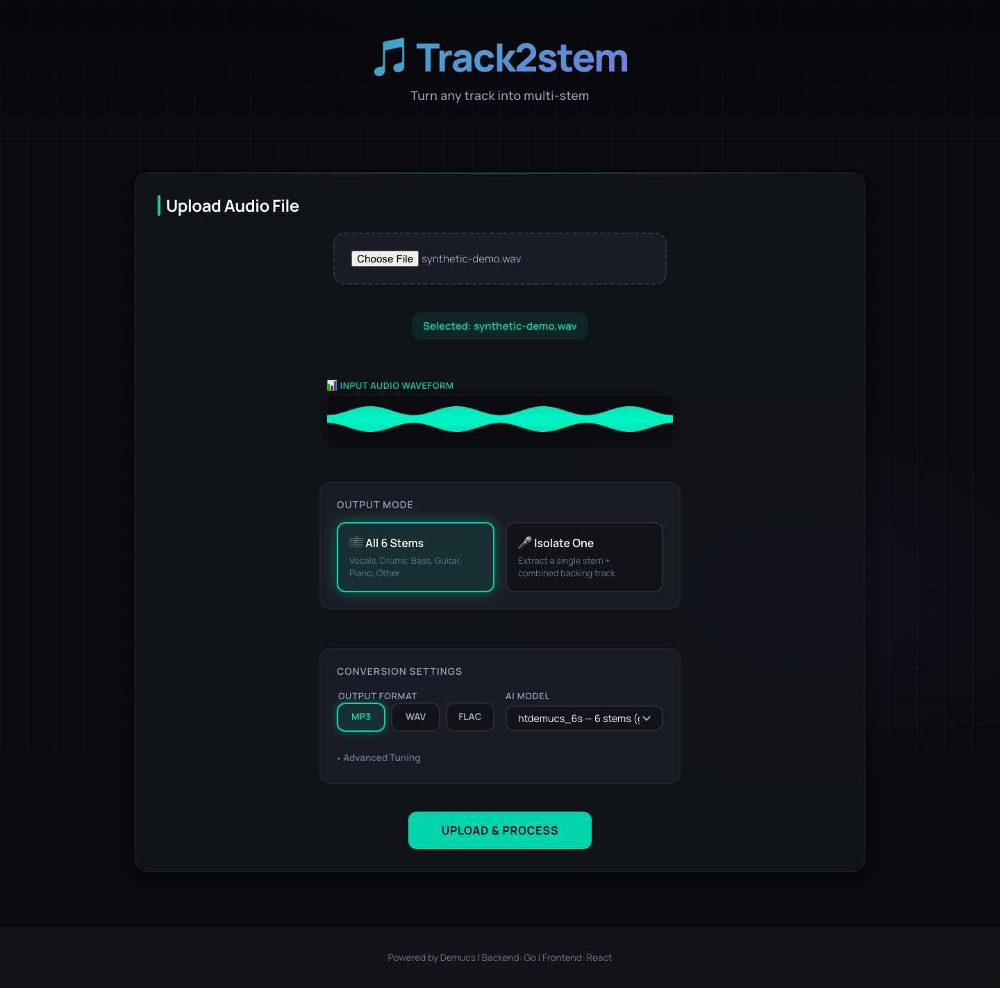

# Track2stem

[](https://github.com/mbianchidev/track2stem/actions/workflows/ci.yml)

[Documentation](docs/README.md) | [Report a bug](https://github.com/mbianchidev/track2stem/issues) | [Roadmap](docs/roadmap.md)



*The upload workflow with a generated WAV sample. No personal audio or simulated separation results are shown.*

Track2stem is a self-hosted web application for musicians and audio enthusiasts who want separate vocal and instrument tracks for practice, remixing, or transcription. Upload audio, choose a Demucs model, and download all available stems or one isolated instrument with a backing track.

## Contents

[Quickstart](#quickstart) | [Why Track2stem](#why-track2stem) | [How it works](#how-it-works) | [Get started](#get-started) | [Features](#features) | [Documentation](#documentation) | [AI policy](#ai-policy) | [Contributing](#contributing) | [License](#license)

## Quickstart

Install Git, a Docker-compatible runtime for Linux containers, and Docker Compose v2. On macOS or Windows, use a runtime that supports Linux containers. Start with at least 8 GB of RAM available to the runtime, several GB of free disk space, internet access, and free host ports 3000 and 8080.

```bash
git clone https://github.com/mbianchidev/track2stem.git
cd track2stem
docker compose build --no-cache
docker compose up -d --wait --wait-timeout 300
curl --fail http://localhost:8080/api/health
```

The health endpoint should return `{"status":"ok"}`. Open http://localhost:3000, select an audio file below 100 MiB, choose an output mode, and click **Upload & Process**. Download each stem when the job completes.

No host Node.js, Go, Python, or GPU installation is needed. Processing is CPU-only; the first job downloads the selected model. Startup health checks do not test model inference. See [troubleshooting](docs/troubleshooting.md) if startup or processing fails.

**Use on a trusted local network only.** The supplied stack has no authentication, enables Flask debug mode, and exposes its web/API ports on all host interfaces. Job records are lost when the backend restarts, even if audio volumes survive. Read the [deployment and data limitations](docs/configuration.md#limitations-and-data-lifecycle).

## Why Track2stem

Use a browser instead of assembling Demucs commands yourself, keep audio processing on your own host, and choose between individual instruments or a ready-mixed backing track. The supplied CPU-only setup avoids a GPU prerequisite, but processing speed and separation quality depend on the hardware, source, and model.

## How it works

The React/Vite interface uploads audio to a Go API, which tracks jobs and forwards work to a Python/Flask processor running [Demucs](https://github.com/facebookresearch/demucs). FFmpeg handles backing mixes and FLAC conversion; shared Docker volumes hold audio files. See the [architecture guide](docs/development.md#architecture).

## Get started

Follow the [usage guide](docs/usage.md) for model selection, isolate mode, formats, and advanced tuning. Defaults are `htdemucs_6s`, all six stems, and MP3 output.

Read [configuration and operations](docs/configuration.md) before changing ports or environment variables. The supplied Compose file does not wire up `.env.example`; the frontend uses Vite's `VITE_API_URL`, not the legacy `REACT_APP_API_URL`.

## Features

- Six stems with `htdemucs_6s`, or four stems with seven alternative Demucs models.
- All stems or one isolated instrument plus a mixed backing track.
- MP3, WAV, FLAC, OGG, M4A, and AAC inputs; MP3 at 320 kbps, WAV, and FLAC outputs.
- Processing status, elapsed time, audio waveforms, and browser-local recent-job history.
- Individual downloads and an HTTP API for jobs, progress, and best-effort cancellation.

Planned persistence, authentication, queues, and observability are listed separately in the [roadmap](docs/roadmap.md).

## Documentation

Start at the [documentation index](docs/README.md). It links user guides for usage, configuration, data cleanup, and troubleshooting, plus the [API reference](docs/api.md) and [developer setup, architecture, and testing guide](docs/development.md).

## AI policy

You are responsible for everything you contribute, including AI-assisted code, documentation, and assets. Review and test your contribution. You must be able to explain what it does and why it is needed.

## Contributing

Contributions are welcome. Read [CONTRIBUTING.md](CONTRIBUTING.md) for the contribution workflow and links to developer and agent instructions. Report reproducible bugs through the [issue tracker](https://github.com/mbianchidev/track2stem/issues) without sharing private audio or credentials.

## License

Track2stem is licensed under the [MIT License](LICENSE). It builds on Demucs, originally developed by Facebook Research; the [upstream repository](https://github.com/facebookresearch/demucs) is archived.
